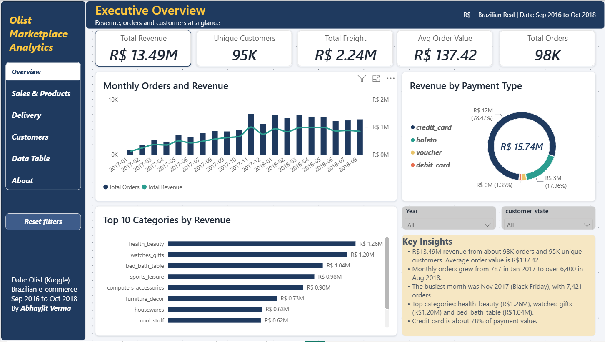
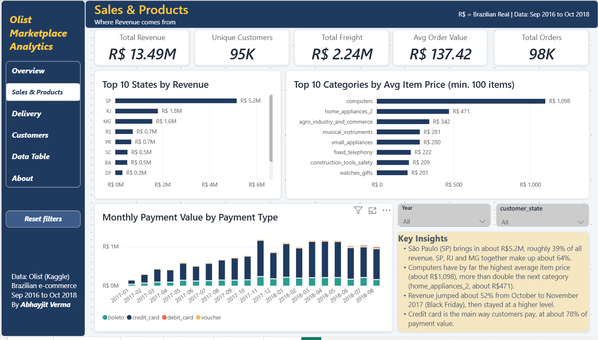
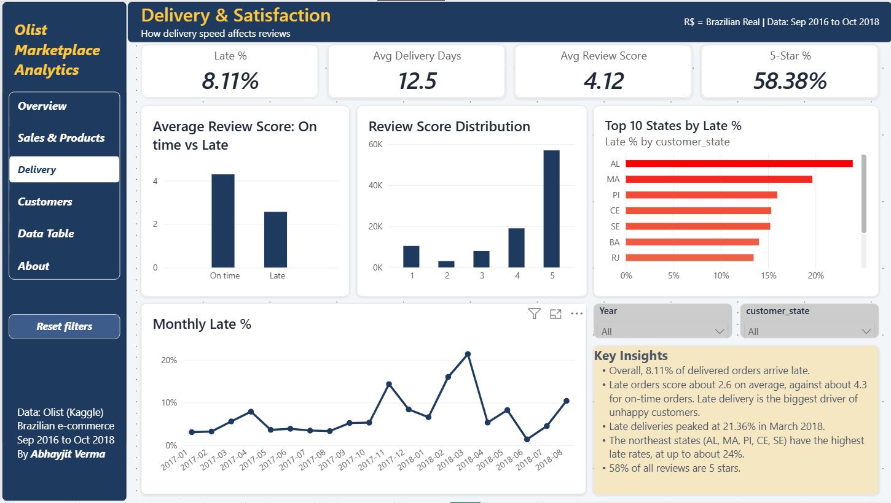
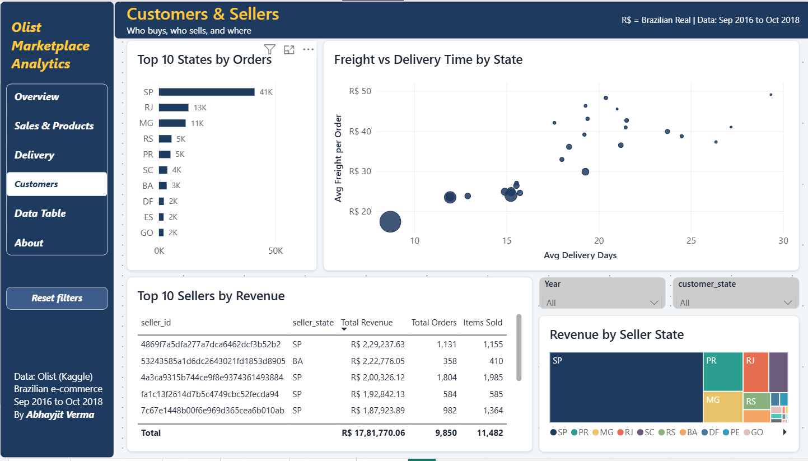
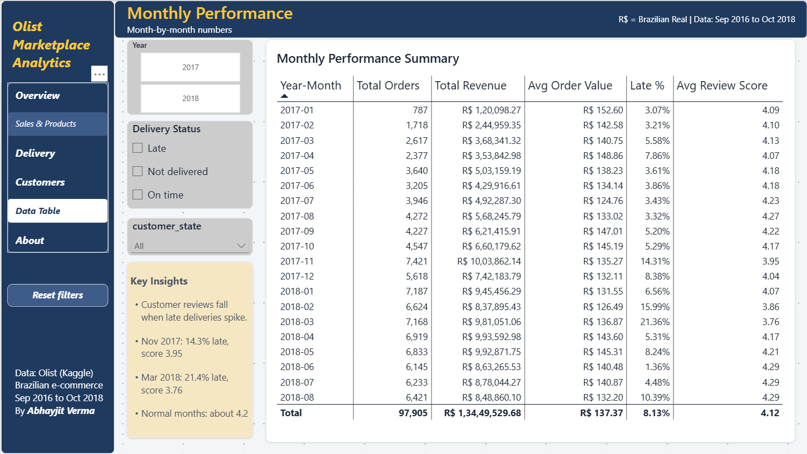
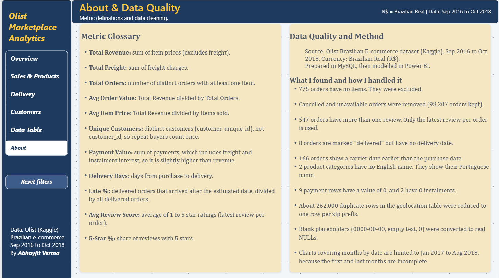

# Olist Marketplace Analytics

End-to-end analysis of a Brazilian e-commerce marketplace: **MySQL** for cleaning and analysis, **Power BI** for a 6-page interactive dashboard.

**98K orders | 1.5M+ records across 9 tables | Sep 2016 to Oct 2018 | Revenue R$13.49M**

## Business questions

1. How much revenue does the marketplace make, and how did it grow month by month?
2. Which categories, states and payment types drive revenue?
3. How often are orders delivered late, and what does that do to customer reviews?
4. Where are the customers and sellers, and how do distance and freight affect delivery?

## Tools

- **MySQL 8.0** (Workbench): data loading, cleaning, views, analysis queries
- **Power BI Desktop**: data model, DAX measures, dashboard
- **Connection:** MySQL ODBC driver (64-bit) into Power BI

## Project workflow

1. **Load** the 9 CSV files into MySQL (`olist_db`) with `CREATE TABLE` and `LOAD DATA LOCAL INFILE`.
2. **Clean** the data: blank values loaded as placeholders (zero dates, empty text, zero numbers) were converted to real `NULL`s.
3. **Build clean views** (`v_orders_clean`, `v_reviews_clean`, `v_order_items_clean`, `v_order_payments_clean`, `v_geolocation_zip`) so the dashboard reads only valid data.
4. **Analyse** in SQL: revenue, orders per month, top categories and states, delivery time, late-delivery rate, payment split, review scores, top sellers.
5. **Model** in Power BI: star-style model with a marked Date Table, one-to-many relationships, and DAX measures.
6. **Visualise** in a 6-page dashboard with consistent colours and filters.

## Data model

Customers 1-1 Orders; Orders 1-many Order Items and Payments; Orders 1-1 Reviews; Products 1-many Order Items; Sellers 1-many Order Items; Category Translation 1-many Products; Date Table 1-many Orders.

## Dashboard pages

### 1. Overview
Revenue, orders, customers, average order value, monthly trend, payment types, top categories.



### 2. Sales & Products
Revenue by state, categories by average item price, monthly payment value.



### 3. Delivery & Satisfaction
Late %, delivery days, review score by delivery status, late % by state.



### 4. Customers & Sellers
Orders by state, freight vs delivery time, top sellers, revenue by seller state.



### 5. Monthly Performance
Month-by-month performance table with filters.



### 6. About & Data Quality
Metric definitions and data-cleaning notes.



## Key findings

- **R$13.49M** revenue from about **98K orders** and **95K unique customers**; average order value **R$137.42**.
- Monthly orders grew from **787 (Jan 2017)** to over **6,400 (Aug 2018)**. The peak was **Nov 2017** (Black Friday) with 7,421 orders.
- **São Paulo** brings in about R$5.2M (roughly 39% of revenue); SP, RJ and MG together are about 64%.
- **Credit card** is about 78% of payment value.
- **8.11%** of delivered orders arrived late. Late orders score about **2.6** on average vs about **4.3** for on-time orders.
- Late delivery peaked at **21.4% in March 2018**; reviews fell to 3.76 that month.
- North-east states (AL, MA, PI, CE, SE) have the highest late rates, up to about 24%.
- Far-north states wait 20 to 30 days and pay R$40 to 50 freight per order; São Paulo gets the shortest delivery and lowest freight.
- The top 10 sellers account for about 13% of revenue; 9 of 10 are in São Paulo.

## Data-quality findings

- 775 orders have no items.
- 8 orders are marked "delivered" but have no delivery date.
- 166 orders have a carrier date before the purchase date.
- 547 orders have more than one review (the latest review is used).
- 2 product categories have no English translation.
- 9 payment rows have a value of 0.
- About 262K duplicate rows in the geolocation table (compared case- and accent-sensitively).
- Canceled and unavailable orders are removed in the clean views (98,207 orders remain).

## Key DAX measures

```
Total Revenue = SUM('Order Items'[price])
Total Orders = DISTINCTCOUNT('Order Items'[order_id])
Avg Order Value = DIVIDE([Total Revenue], [Total Orders])
Late % = DIVIDE([Late Orders], [Delivered Orders])
Avg Review Score = AVERAGE(Reviews[review_score])
```

All measures are in the `.pbix` file.

## Repository contents

```
sql/            SQL scripts (load, clean, views, analysis)
powerbi/        Olist-Marketplace-Analytics.pbix
screenshots/    Dashboard page images (6 pages)
README.md
```

The raw CSV files are not included. Download them from Kaggle (link below).

## How to reproduce

1. Download the dataset from Kaggle and load it into MySQL with the scripts in `sql/` (in numbered order).
2. Install the 64-bit MySQL ODBC driver.
3. In Power BI: Get data > ODBC, with `Driver={MySQL ODBC 26.7 Unicode Driver};Server=localhost;Port=3306;Database=olist_db;`
4. Open the `.pbix` and refresh.

## Data source

[Brazilian E-Commerce Public Dataset by Olist](https://www.kaggle.com/datasets/olistbr/brazilian-ecommerce) on Kaggle. Please check the licence on that page. This is an independent portfolio project and is not affiliated with or endorsed by Olist.

## Author

**Abhayjit Verma**, New Delhi, India
[LinkedIn](https://www.linkedin.com/in/abhayjit-verma) | [GitHub](https://github.com/abhay-verma007)
